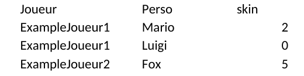
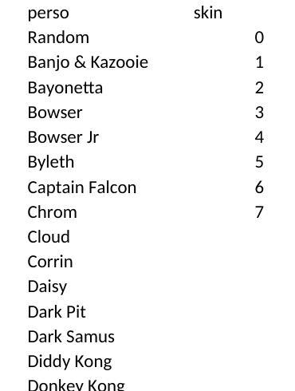

# Top8er Automation (SSBU)

Génère automatiquement un visuel "Top 8" sur [top8er.com/old/ssbu](https://www.top8er.com/old/ssbu)
à partir d'un lien de tournoi start.gg, de l'usage réel des personnages en jeu, et d'un
fichier de skins de référence.

Voir [`SPEC.md`](./SPEC.md) pour le détail des règles fonctionnelles.

## Installation

### Linux / macOS

```bash
./scripts/install.sh
```

ou manuellement :

```bash
pip install --user requests beautifulsoup4 openpyxl
```

### Windows

Installer [Python 3](https://python.org) (cocher *Add python.exe to PATH* pendant
l'installation), puis depuis PowerShell :

```powershell
.\scripts\install.ps1
```

ou manuellement :

```powershell
python -m pip install --user requests beautifulsoup4 openpyxl
```

Si PowerShell bloque l'exécution du script (`execution of scripts is disabled`) :

```powershell
powershell -ExecutionPolicy Bypass -File .\scripts\install.ps1
```

### Mode `--review` (facultatif)

En plus des dépendances ci-dessus (les scripts d'install le proposent automatiquement) :

```bash
pip install --user playwright
```

Un Google Chrome déjà installé sur la machine suffit (le script le pilote via
`channel="chrome"`) — pas besoin de `playwright install`, sur Linux comme sur Windows.

## Données locales requises

Ce repo ne versionne pas les données spécifiques à un contexte (pseudos réels de joueurs,
police avec licence non vérifiée). À placer soi-même avant de lancer le script :

- `data/skin.xlsx` — le fichier de skins (voir format détaillé ci-dessous).

La police est facultative : pour utiliser une police custom, passer son chemin avec `--font`.
Sans cette option, aucun fichier de police n'est envoyé à Top8er.

### Format du fichier skin (`data/skin.xlsx`)

Tableur avec deux feuilles :

- **Sheet1** — une ligne par **couple (joueur, personnage)** : colonnes `Joueur | Perso | skin`.
  **Un joueur qui a plusieurs persos connus a donc plusieurs lignes** (une par perso), toutes
  avec le même nom dans la colonne `Joueur` — il n'y a pas de colonne séparée par perso
  (plus de MAIN/SECONDARY/TERTIARY).
- **Listes** — feuille annexe servant de source aux deux listes déroulantes de Sheet1 :
  colonne `perso` (roster SSBU complet) et colonne `skin` (0 à 7).

| Joueur | Perso | skin |
|---|---|---|
| ExampleJoueur1 | Mario | 2 |
| ExampleJoueur1 | Luigi | 0 |
| ExampleJoueur2 | Fox | 5 |

(ici ExampleJoueur1 a deux lignes, une par personnage ; ExampleJoueur2 n'en a qu'une.)

Si plusieurs lignes donnent un skin différent pour le même (joueur, perso) — par exemple
après une mise à jour —, le script garde le skin le plus bas qui n'est pas 0 (0 uniquement
s'il n'y a pas d'autre valeur).

Fichier d'exemple déjà rempli, avec les listes déroulantes en place :
[`data/skin.example.xlsx`](./data/skin.example.xlsx) — à copier/renommer en `data/skin.xlsx`
et à compléter avec tes propres joueurs. Captures d'écran du format ci-dessous.




### Migrer depuis l'ancien format

L'ancien format (`Nom | MAIN | SECONDARY | TERTIARY`, un perso par colonne) peut être converti
automatiquement :

```bash
python3 src/migrate_skins_format.py "ancien.xlsx" "nouveau.xlsx"
```

Les cellules ambiguës de l'ancien format (plusieurs choix, couleur manquante, perso non
reconnu) ne sont pas migrées automatiquement et sont listées en sortie pour complétion
manuelle dans le fichier généré (qui a déjà les listes déroulantes perso/skin).

## Utilisation

**Linux / macOS :**

```bash
python3 src/top8er_bot.py "<lien de tournoi start.gg>" \
  --startgg-token <token API start.gg> \
  --main-color "#f1c4ee" \
  --highlight-color "#cecece"
```

Les options `--background <image.png/webp>` et `--logo <logo.png/webp>` sont facultatives ;
ajoute-les à la commande si tu veux fournir ces fichiers.

**Windows (PowerShell ou invite de commandes), depuis la racine du repo :**

```powershell
python src\top8er_bot.py "<lien de tournoi start.gg>" --startgg-token <token API start.gg>
```

(sur Windows, la commande est `python` et non `python3` ; les chemins utilisent `\` au lieu
de `/`, et l'enchaînement de lignes avec `\` ne fonctionne pas en PowerShell — tout tenir sur
une seule ligne, ou utiliser `` ` `` en fin de ligne si tu préfères du multi-lignes.)

Le token API start.gg se génère gratuitement sur
[developer.start.gg](https://developer.start.gg) → Developer Settings → Create new token.

### Arguments

| Argument | Obligatoire | Rôle |
|---|---|---|
| `tournament_link` (positionnel) | oui | Lien start.gg du bracket |
| `--background` | non | Image de fond du visuel (non envoyée si omise) |
| `--logo` | non | Logo (remplace le texte en haut à gauche ; non envoyé si omis) |
| `--startgg-token` | oui | Token API start.gg |
| `--skins` | non | Chemin du xlsx de skins (défaut : `data/skin.xlsx`) |
| `--font` | non | Chemin facultatif de la police custom (aucun fichier envoyé si omis) |
| `--main-color` | non | Couleur principale au format `#RRGGBB` (défaut : `#f1c4ee`) |
| `--highlight-color` | non | Couleur de surbrillance au format `#RRGGBB` (défaut : `#cecece`) |
| `--outdir` | non | Dossier de sortie (défaut : `output/`) |
| `--review` | non | Bloque avant la génération finale : ouvre un vrai navigateur (profil Chrome isolé, dédié à cet usage) avec le formulaire déjà pré-rempli par nos calculs (skins + persos joués), pour relecture/modification manuelle. Rien n'est généré automatiquement : c'est à toi de cliquer sur "Generate" dans le navigateur. Le script rend la main quand tu fermes la fenêtre. |

### Sortie

- `output/<timestamp>-<slug>.png` — l'image finale
- `output/<timestamp>-<slug>.response.html` — réponse brute du site (debug)

Le script affiche aussi en console, pour chaque joueur, les personnages retenus (avec leur
nombre de games joués et la source de leur couleur) ainsi que les lignes du xlsx ignorées
car ambiguës.

## Licence et avertissement

Le code de ce repo est sous licence MIT (voir [`LICENSE`](./LICENSE)) : libre réutilisation,
modification et redistribution, sans garantie.

Ce projet n'est ni affilié à, ni approuvé par Top8er ou start.gg. Il automatise un
formulaire public de Top8er et appelle l'API GraphQL de start.gg ; utiliser ce script reste
soumis à leurs propres conditions d'utilisation respectives (notamment les *Developer
Terms* de start.gg, acceptées lors de la création d'un token API) — la licence MIT ci-dessus
porte uniquement sur le code de ce repo, elle n'accorde aucun droit d'usage sur ces services
tiers.
